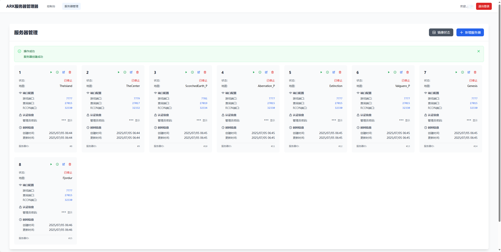
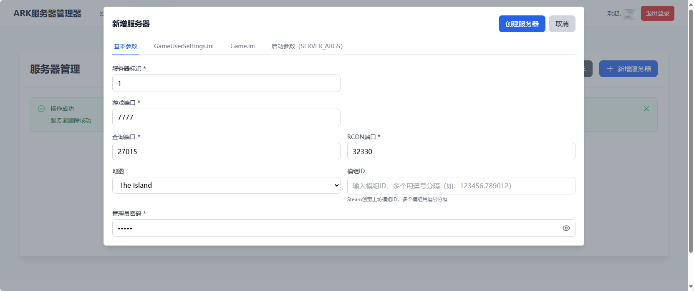
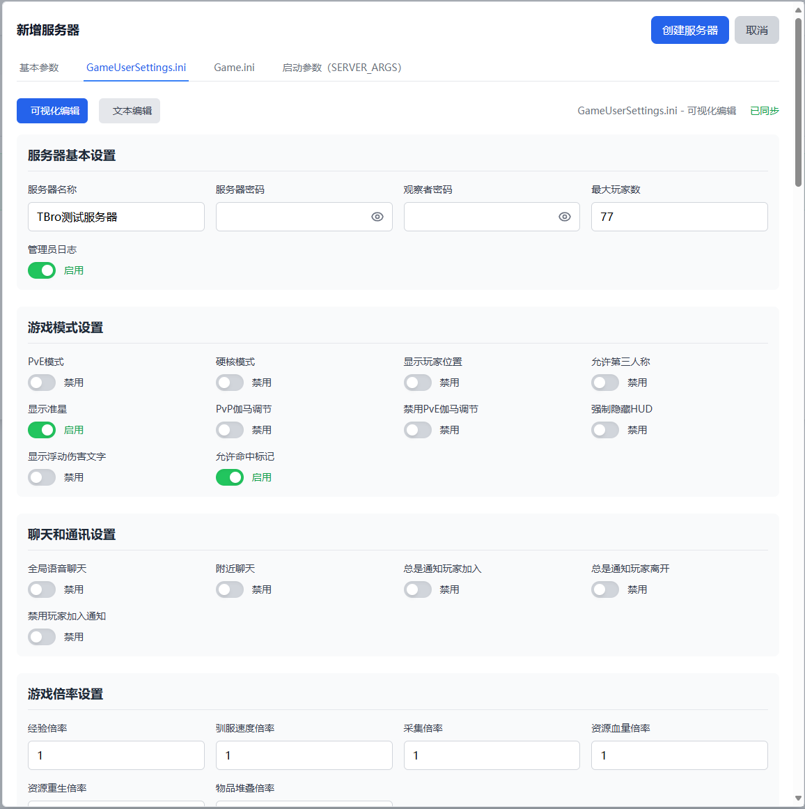
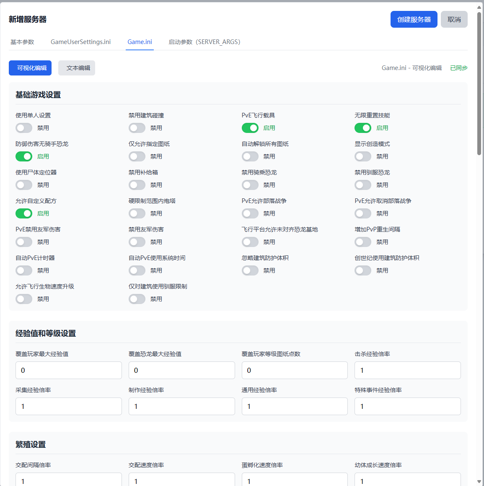
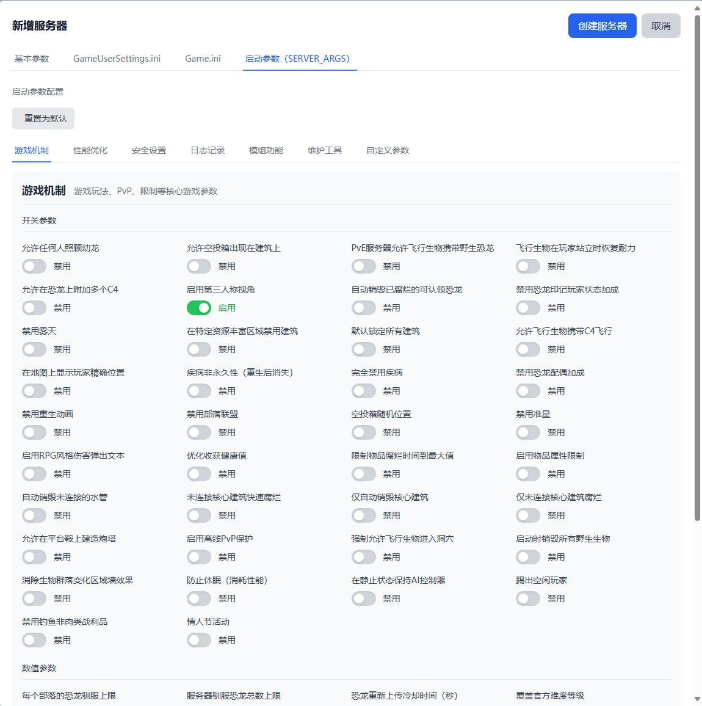

# ARK 服务器管理器

> ⚠️ **开发阶段提示**：本项目目前仍处于开发阶段，功能可能不完整或存在稳定性问题。建议仅用于测试环境，不建议在生产环境中使用。

[English](README.md) | [中文](README-zh.md)

- Linux上的 ARK 生存进化服务器管理工具。
- 默认运行原生 Linux 版服务端；需要插件时可以按服务器启用 ArkApi（用 GE-Proton 运行 Windows 版服务端）。

## 🎮 功能特性

### ✅ 已实现功能
- 🐳 每个ARK服务器运行在独立的Docker容器中
- 🔌 每台服务器可单独启用 ArkApi：启用后用 Proton 镜像运行 Windows 版服务端，关闭时用原生 Linux 版，切换后下次启动自动换镜像
- 🔄 服务器容器支持崩溃自动重启
- ⬆️ 首次启动时自动下载服务端文件和Mod，文件保存在独立的卷里，重建容器不会重新下载；新服务器从已安装的服务器复制服务端文件
- 💾 存档、配置、插件和服务端文件保存在 `data/servers/<编号>/` 下，宿主机可直接管理；删除服务器时默认保留，也可选择一并删除
- 🖥️ 添加和管理多个 ARK 服务器，支持集群（共享集群目录）
- ⚙️ 可视化或文本方式编辑 GameUserSettings.ini、Game.ini 和启动参数
- ▶️ 一键启动/停止/重启服务器，修改启动参数或Mod后启动时自动重建容器
- 📊 运行状态监控：下载进度、安装Mod进度、是否可连接、在线人数、CPU/内存/磁盘
- 📋 实时查看服务器日志（容器输出和游戏的 ShooterGame.log）
- 🎮 RCON 控制台：执行命令、广播、保存世界，在线玩家踢出/封禁
- 💾 存档备份：手动备份、下载、上传、恢复
- ⏰ 定时任务：定时重启（提前广播）、备份、更新、执行命令、启动/停止
- ⚡ 一键更新服务端文件和Mod，或每次启动时自动更新
- 🎨 Mod管理：显示创意工坊名称和预览图，粘贴链接自动识别ID，拖动调整加载顺序，检测Mod更新并只更新有变化的Mod
- 🔧 ArkApi 管理：内置 3.56，可从 GitHub 下载或上传 zip 安装其他版本并一键更新；插件上传 zip 安装、启用/停用、删除，在线编辑插件和 ArkApi 的 config.json
- 🖼️ Docker镜像管理：下载、检查更新、更新镜像；更新后服务器在下次启动时自动用新镜像重建容器，也可选择立即重启运行中的服务器
- 🔐 管理员账号登录（JWT认证，密钥由后端自动生成，无需配置），可修改登录密码
- 🔍 工具版本更新检查（设置页）
- 🧹 清理不再使用的集群数据
- 🌐 中文/英文界面切换
- 📝 API文档（Swagger，本地直接运行后端时可访问）
- 🤖 MCP 接口，Claude Code、Claude Desktop、Cursor 等 Agent 可以直接管理服务器，支持完全控制和只读两种令牌

### 🚧 待实现功能
开发计划和进度见 [docs/DEV_PLAN.md](docs/DEV_PLAN.md)。
- 👤 多用户管理
- 🔌 MCP 支持

### 🚀 未来计划
- ☸️ 多主机管理，可能基于K8S实现
- 🌍 服务器收录网站，脱离糟糕的steam搜服
- 👥 玩家使用界面

## 🚀 快速开始

### 🔧 系统要求

- 每个ARK服务器 8GB+ 内存 (推荐)
- 每个ARK服务器 20GB+ 磁盘空间

### 📦 安装 1Panel
推荐在服务器上安装1Panel来管理docker环境
[1Panel安装文档](https://1panel.cn/docs/v2/installation/online_installation/)

### 🐳 Docker容器化部署

拷贝docker-compose.yml，或直接复制：
```yml
services:
  # ARK服务器管理系统 (前后端一体)
  ark-commander:
    image: tbro98/arkservercommander:latest
    container_name: ark-commander
    ports:
      # 可修改端口映射
      - "8080:8080"
    volumes:
      # 数据库和自动生成的登录密钥
      - ./data:/data
      # Docker socket (用于管理Docker容器)
      - /var/run/docker.sock:/var/run/docker.sock
    restart: unless-stopped
    # 系统需要操作宿主机Docker的特权模式
    privileged: true
```

无需额外配置。如果通过 HTTPS 访问，需要添加环境变量 `COOKIE_SECURE=true`，其他可选项见 [.env.example](.env.example)。

# 🚀 启动服务
```
sudo docker-compose up -d
```

🌐 通过 ip+端口，访问系统界面

## 📖 使用说明

### 🆕 首次使用
1. 系统会自动跳转到初始化页面
2. 设置您的管理员账号和密码
3. 初始化完成后登录系统

### 🖥️ 管理服务器
1. 登录后点击"服务器管理"
2. 点击"添加服务器"创建新的服务器配置

### 🤖 Agent 接入（MCP）
管理器内置 MCP（Model Context Protocol）服务，Agent 不需要网页界面就能管理服务器：查看状态、启停和重启、创建和修改服务器、修改单个配置项、执行 RCON 命令、查看日志和在线玩家、管理备份、定时任务、插件和镜像。

1. 打开 **设置 → Agent 接入（MCP）**，填写令牌名称后点击 **创建**（只想让 Agent 查看时打开 **只读**）。令牌只显示一次。
2. 在 Agent 中添加 MCP 服务，以 Claude Code 为例：
   ```bash
   claude mcp add --transport http ark-commander http://<主机>:8080/mcp --header "Authorization: Bearer <令牌>"
   ```
   其他客户端使用同一个地址（Streamable HTTP）和 `Authorization` 请求头，设置页提供可直接复制的 JSON 配置。
3. 在同一页面撤销令牌后立即失效。

**让 Agent 自己安装。** 把下面的 `<主机>` 和 `<令牌>` 换成实际值，再把整段话发给你的 Agent（Claude Code、Cursor、Codex 等）：

```text
请通过 MCP 连接我的 ARK Server Commander。添加一个名为 "ark-commander" 的 MCP 服务，传输方式为 Streamable HTTP，地址 http://<主机>:8080/mcp，请求头 "Authorization: Bearer <令牌>"。如果你是 Claude Code，执行：claude mcp add --transport http --scope user ark-commander http://<主机>:8080/mcp --header "Authorization: Bearer <令牌>"；否则把等价的配置写进你的 MCP 客户端配置文件（{"mcpServers": {"ark-commander": {"type": "http", "url": "http://<主机>:8080/mcp", "headers": {"Authorization": "Bearer <令牌>"}}}}），与已有的服务合并，不要覆盖。令牌不要提交到版本库，也不要在回复里原样输出。完成后告诉我是否需要重启或重新加载才能生效；工具可用后调用 list_servers，汇总每台服务器的名称、状态、地图和在线人数。
```

MCP 地址和网页使用同一个端口。如果暴露在公网，请放在 HTTPS 反向代理后面，因为每次请求都会带上令牌。上传插件、上传和下载备份只能在网页上操作。

### 🗺️ 支持的地图 - 后续可扩展自定义增加
- The Island (孤岛)
- The Center (中心岛)
- Scorched Earth (焦土)
- Aberration (畸变)
- Extinction (灭绝)
- Valguero (瓦尔盖罗)
- Genesis (创世纪)
- Crystal Isles (水晶岛)
- Genesis 2 (创世纪2)
- Lost Island (失落岛)
- Fjordur (峡湾)

## ❓ 常见问题

### ❓ Q: 如何备份ARK服务器数据？
A: 在服务器详情页的"备份"标签中手动备份、下载、上传和恢复存档，也可以在"定时任务"中设置定时备份。备份文件保存在 `data/backups/<服务器编号>/`。服务器的全部数据在宿主机 `data/servers/<服务器编号>/` 下，也可以自行备份。

### ❓ Q: 如何查看ARK服务器日志？
A: 在服务器详情页的"日志"标签中实时查看，可以暂停、筛选和下载。切换到"游戏日志"可以看游戏本身的 `ShooterGame.log`（文件在 `data/servers/<服务器编号>/saved/Logs` 下）。

### ❓ Q: 如何更新ARK服务器镜像？
A: 登录后在首页的"镜像管理"中点击"检查更新"，有新版本时点击"更新"。确认时可以选择：
- **仅更新镜像**：运行中的服务器不受影响，下次启动时自动用新镜像重建容器
- **更新镜像并重启运行中的服务器**：下载完成后立即停止、重建并重新启动这些服务器

使用旧镜像的服务器卡片上会显示"旧镜像"标记。服务端文件、存档和配置都保存在卷中，重建容器不会丢失，也不需要重新下载。

### ❓ Q: 登录用的密钥在哪里？需要配置吗？
A: 不需要。后端首次启动时会自动生成强随机密钥，保存在数据目录下的 `jwt_secret` 文件中（即挂载的 `./data/jwt_secret`）。删除该文件并重启容器会让所有已登录的会话失效。

### 🖼️ ARK服务器镜像
- 未启用 ArkApi 的服务器使用 `tbro98/ase-server:linux`（原生 Linux 版服务端），启用 ArkApi 的使用 `tbro98/ase-server:proton`（GE-Proton 运行 Windows 版）
- 服务器用到的镜像还没下载时，启动会自动下载；镜像不再包含 ArkApi，由管理器安装到服务端文件里
- `tbro98/ase-server:latest` 不再更新，停留在最后一个自带 ArkApi 的版本，只供旧版管理器使用
- 镜像源地址: [ASE-Server-Docker](https://github.com/tbro199803/ASE-Server-Docker)

## 📸 界面展示




 