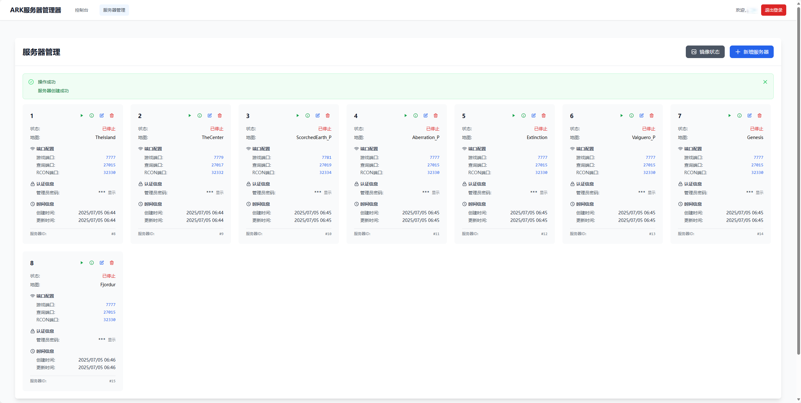
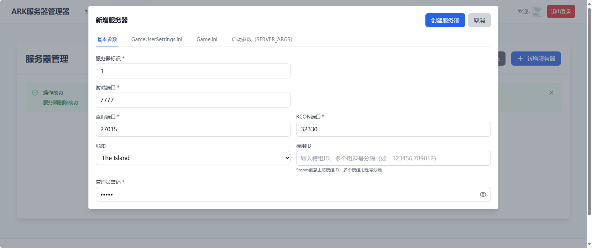
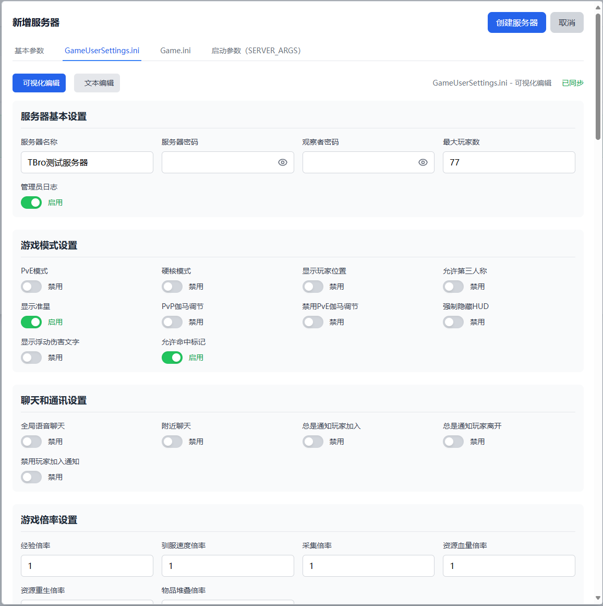
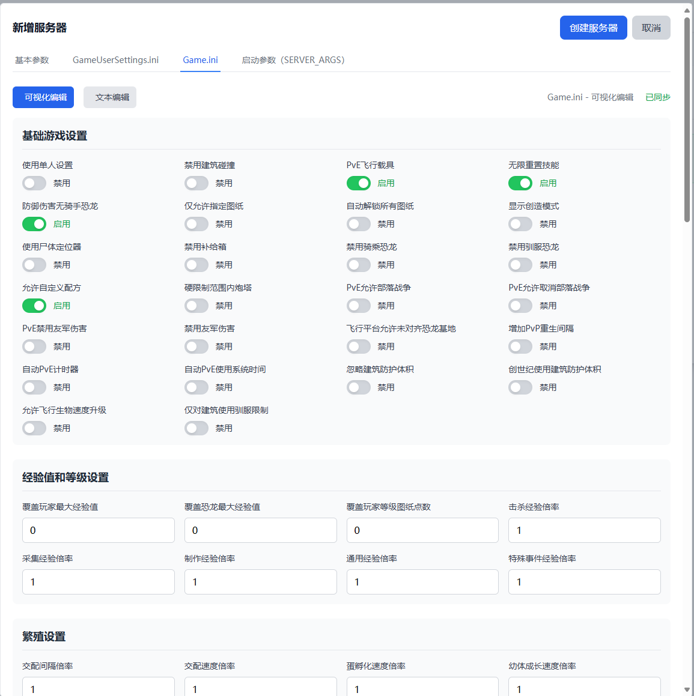
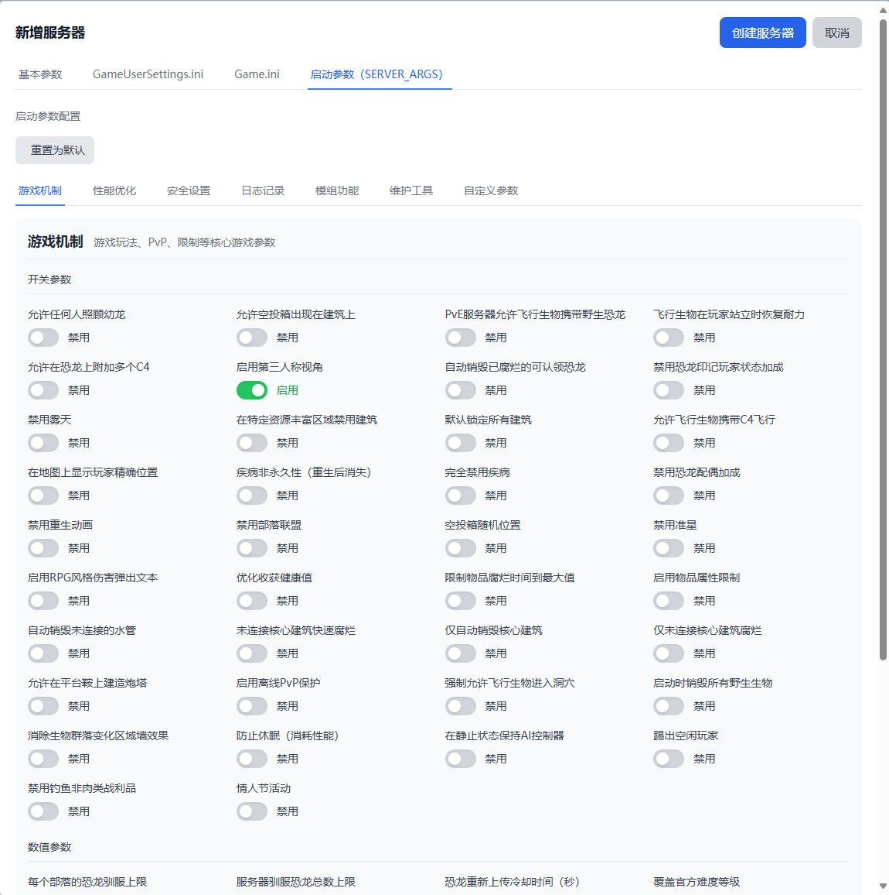

# ARK Server Commander

> ⚠️ **Development Stage Notice**: This project is currently in development stage and features may be incomplete or have stability issues. It is recommended for testing environments only and should not be used in production.

[English](README.md) | [中文](README-zh.md)

- ARK Survival Evolved server management tool for Linux.
- Runs the native Linux server by default; ArkApi can be enabled per server when you need plugins (the Windows server runs under GE-Proton).

## 🎮 Features

### ✅ Implemented Features
- 🐳 Each ARK server runs in an independent Docker container
- 🔌 ArkApi can be enabled per server: enabled servers run the Windows build on the Proton image, others run the native Linux build; switching takes effect on the next start
- 🔄 Server containers support automatic restart on crash
- ⬆️ Server files and mods are downloaded on first start and kept on their own volume, so recreating a container does not download them again; new servers copy server files from an already installed server
- 💾 Saves, configs, plugins and server files live under `data/servers/<id>/` and can be managed directly on the host; they are kept when a server is deleted unless you choose to delete them
- 🖥️ Add and manage multiple ARK servers, with cluster support (shared cluster directory)
- ⚙️ Edit GameUserSettings.ini, Game.ini and launch arguments visually or as text
- ▶️ One-click server start/stop/restart; containers are recreated automatically on start after launch arguments or mods change
- 📊 Status monitoring: download and mod install progress, joinable state, online players, CPU/memory/disk
- 📋 Live server log viewing (container output and the game's ShooterGame.log)
- 🎮 RCON console: run commands, broadcast, save world; kick/ban online players
- 💾 Save backups: manual backup, download, upload, restore
- ⏰ Scheduled tasks: restart (with advance broadcast), backup, update, command, start/stop
- ⚡ One-click server file and mod updates, or automatic update on every start
- 🎨 Mod management: Workshop names and previews, paste a Workshop link to add a mod, drag to reorder, detect mod updates and update only the changed mods
- 🔧 ArkApi management: 3.56 is built in, other versions can be downloaded from GitHub or uploaded as a zip and installed with one click; plugins can be installed from zip, enabled/disabled, deleted, and their config.json and ArkApi's edited online
- 🖼️ Docker image management: download, check for updates, update; after an update, servers recreate their containers with the new image on next start, or running servers can be restarted right away
- 🔐 Administrator login (JWT authentication, secret generated automatically by the backend, no configuration needed), with password change
- 🔍 Tool version update checking (settings page)
- 🧹 Clean up cluster data that is no longer used
- 🌐 Chinese / English interface
- 📝 API documentation (Swagger, available when running the backend locally)
- 🤖 MCP endpoint for agents (Claude Code, Claude Desktop, Cursor…), with full-control or read-only access tokens

### 🚧 Planned Features
See [docs/DEV_PLAN.md](docs/DEV_PLAN.md) for the development plan and progress.
- 👤 Multi-user management
- 🔌 MCP (Model Context Protocol) support

### 🚀 Future Plans
- ☸️ Multi-host management based on K8S
- 🌍 Server listing website, breaking free from poor Steam server search
- 👥 Player user interface

## 🚀 Quick Start

### 🔧 System Requirements

- 8GB+ memory per ARK server (recommended)
- 20GB+ disk space per ARK server

### 📦 Install 1Panel
We recommend installing 1Panel on your server to manage the Docker environment
[1Panel Installation Guide](https://1panel.cn/docs/v2/installation/online_installation/)

### 🐳 Docker Containerized Deployment

Copy the docker-compose.yml, or use the following configuration directly:
```yml
services:
  # ARK Server Management System (Frontend + Backend)
  ark-commander:
    image: tbro98/arkservercommander:latest
    container_name: ark-commander
    ports:
      # You can modify the port mapping
      - "8080:8080"
    volumes:
      # Database and the auto-generated login secret
      - ./data:/data
      # Docker socket (for managing Docker containers)
      - /var/run/docker.sock:/var/run/docker.sock
    restart: unless-stopped
    # System requires privileged mode to operate host Docker
    privileged: true
```

No extra configuration is needed. If you access the system over HTTPS, add the environment variable `COOKIE_SECURE=true`; see [.env.example](.env.example) for other options.

# 🚀 Start the service
```
sudo docker-compose up -d
```

🌐 Access the system interface via ip+port

## 📖 User Guide

### 🆕 First Time Use
1. The system will automatically redirect to the initialization page
2. Set up your administrator account and password
3. After initialization, log into the system

### 🖥️ Managing Servers
1. After logging in, click "Server Management"
2. Click "Add Server" to create a new server configuration

### 🤖 Agent Access (MCP)
The commander exposes an MCP (Model Context Protocol) server so agents can manage servers without the web UI: list status, start/stop/restart, create and edit servers, change individual config keys, run RCON commands, view logs and players, manage backups, schedules, plugins and images.

1. Open **Settings → Agent access (MCP)**, enter a token name and click **Create** (turn on **Read-only** for an agent that should only look). The token is shown only once.
2. Add the server to your agent. For Claude Code:
   ```bash
   claude mcp add --transport http ark-commander http://<host>:8080/mcp --header "Authorization: Bearer <token>"
   ```
   Other clients use the same URL (Streamable HTTP) and `Authorization` header; the settings page shows a ready-to-copy JSON config.
3. Revoke a token on the same page; it stops working immediately.

**Let your agent install it.** Replace `<host>` and `<token>` below, then paste the whole paragraph to your agent (Claude Code, Cursor, Codex, etc.):

```text
Please connect to my ARK Server Commander via MCP. Add an MCP server named "ark-commander" using the Streamable HTTP transport, URL http://<host>:8080/mcp, with the request header "Authorization: Bearer <token>". If you are Claude Code, run: claude mcp add --transport http --scope user ark-commander http://<host>:8080/mcp --header "Authorization: Bearer <token>". Otherwise add the equivalent entry to your MCP client config file ({"mcpServers": {"ark-commander": {"type": "http", "url": "http://<host>:8080/mcp", "headers": {"Authorization": "Bearer <token>"}}}}), merging it with any existing servers instead of overwriting them. Keep the token out of version control and do not echo it back to me. When done, tell me if a restart or reload is needed to load the server; once its tools are available, call list_servers and summarize each server's name, status, map and online players.
```

The endpoint uses the same port as the web UI. If it is reachable from the internet, put it behind an HTTPS reverse proxy, because the token is sent with every request. Uploading plugins and uploading/downloading backups are only available in the web UI.

### 🗺️ Supported Maps - Can be extended with custom additions later
- The Island
- The Center
- Scorched Earth
- Aberration
- Extinction
- Valguero
- Genesis
- Crystal Isles
- Genesis 2
- Lost Island
- Fjordur

## ❓ FAQ

### ❓ Q: How to backup ARK server data?
A: Use the "Backups" tab on the server detail page to back up, download, upload and restore saves, or add a scheduled backup under "Schedules". Backups are stored in `data/backups/<server_id>/`. All server data lives under `data/servers/<server_id>/` on the host, which you can also back up yourself.

### ❓ Q: How to view ARK server logs?
A: Open the "Logs" tab on the server detail page to follow logs live, pause, filter and download them. Switch to "Game log" to see the game's own `ShooterGame.log` (stored under `data/servers/<server_id>/saved/Logs`).

### ❓ Q: How to update ARK server images?
A: After logging in, click "Check Updates" under image management on the home page, then click "Update" when a new version is available. When confirming you can choose:
- **Update Image Only**: running servers are not affected and recreate their containers with the new image on next start
- **Update Image and Restart Running Servers**: once the download finishes, those servers are stopped, recreated and started again

Servers still on the old image show an "Old Image" badge on their card. Server files, saves and configs live in volumes, so recreating a container loses nothing and does not download them again.

### ❓ Q: Where is the login secret? Do I need to configure it?
A: No. On first start the backend generates a strong random secret and stores it in `jwt_secret` in the data directory (the mounted `./data/jwt_secret`). Deleting that file and restarting the container invalidates all logged-in sessions.

### 🖼️ ARK Server Image
- Servers without ArkApi use `tbro98/ase-server:linux` (native Linux server); servers with ArkApi use `tbro98/ase-server:proton` (Windows server under GE-Proton)
- A missing image is downloaded automatically when a server that needs it starts; the images no longer ship ArkApi, the manager installs it into the server files
- `tbro98/ase-server:latest` is no longer updated. It stays at the last version that bundled ArkApi, for older manager versions
- Image source: [ASE-Server-Docker](https://github.com/tbro199803/ASE-Server-Docker)

## 📸 Interface Screenshots




 